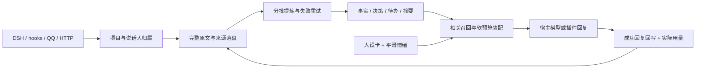
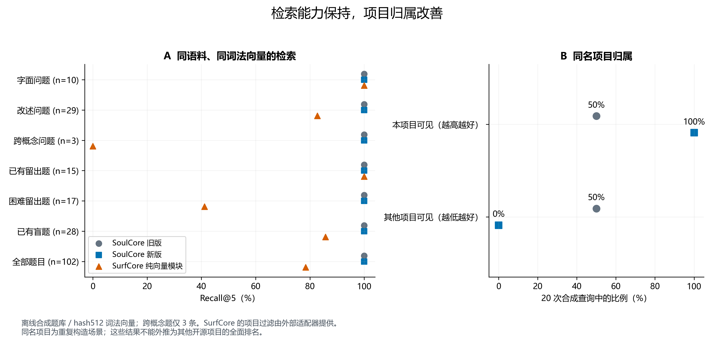
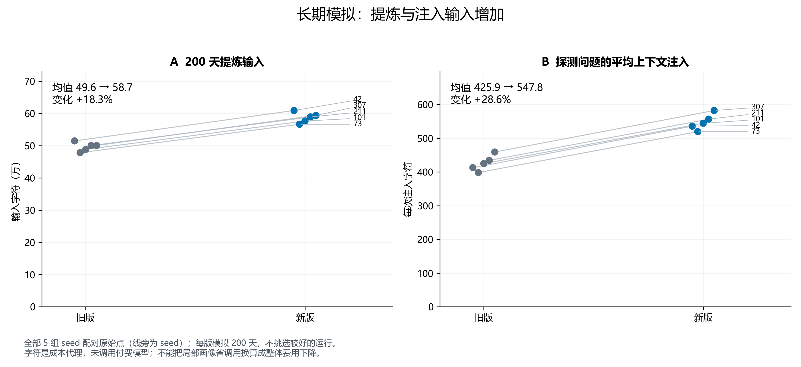
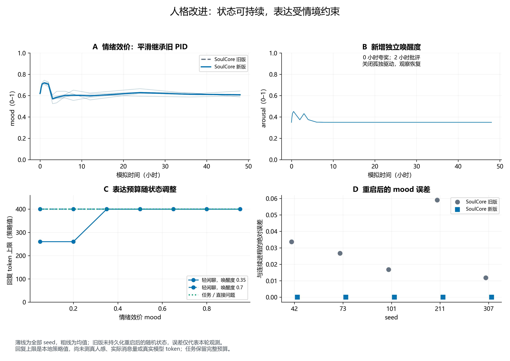
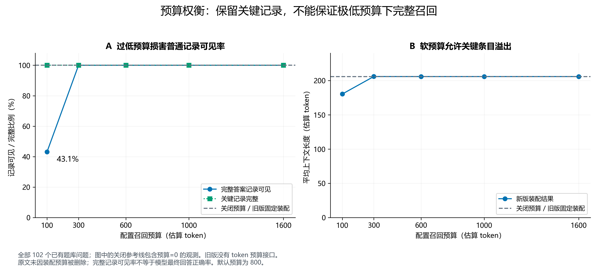

# dsh-soulcore · 持续人格、平滑情绪与长期记忆

SoulCore 给 [DeepSeek Harness（DSH）](https://github.com/deepseek-ai/deepseek-harness) 加上本地长期记忆和持续人格，也支持 Claude Code、MCP、HTTP 与 QQ。它希望解决两个问题：**对话变长或换会话后，项目的重要事实还能找回来；角色对语言有情绪反应，又不会被一句话彻底改变性格。**

核心后端使用 Python 3.10+ 标准库，记忆存于本机 SQLite，并生成可读的 Markdown 镜像。DSH回复由宿主当前选择的模型生成；插件自己的QQ回复、模型提炼、摘要和画像使用 `llm.*` 配置。

当前包版本为 **0.10.1**；本轮增强已进入源码，见 [更新记录](CHANGELOG.md)。未创建独立发行版。**已验证的提升是项目隔离、压缩原文保存、来源追踪和情绪重启连续性；整体降成本目标尚未完成。** 五组长期模拟中，提炼输入增加18.3%、每次注入字符增加28.6%。

## 文档入口

| 你想做什么 | 文档 |
|---|---|
| 安装、试用、换会话找回项目决策 | [快速上手与验收](docs/quickstart.md) · [安装](docs/install.md) |
| 找配置文件、调人格/记忆/费用/QQ参数 | [完整配置说明](docs/config.md) |
| 了解问题、修复和限制 | [开发过程与改进](docs/development-notes.md) |
| 看曲线、数据表与复现方法 | [人格与记忆实测](docs/benchmark/2026-11-memory-affect/README.md) |
| 接其他客户端 | [Claude Code](docs/claude-code.md) · [MCP](docs/mcp.md) · [HTTP API](docs/http-api.md) |
| 在对话里控制记忆、接QQ | [聊天控制](docs/chat.md) · [QQ接入](docs/qq.md) |

## 实现了什么

### 为项目和对话保存长期记忆

- **原文与提炼分开。** 完整用户/助手原文持久保存；压缩前先落盘，再按会话、话题和估算预算分批提炼。提炼摘录长度不限制原文保存长度。
- **来源可追踪。** 记忆关联项目UUID、会话、事件和源记录；提议、接受、实施和有工具验证证据分开处理，避免把“我改好了”当成“测试通过”。
- **失败可重试。** 提炼水位和积压可见；模型异常保留待处理材料，合法空列表才算“已处理但没有新事实”。
- **项目隔离。** 同一home下，同一规范工作目录获得持久UUID；两个都叫 `demo` 的目录分别记忆。保留旧路径兼容，碰撞时不会自动认领有歧义历史。
- **相关召回。** SQLite FTS、概念扩展、重排、时间窗和冷存储共同工作；可选HTTP或fastembed向量。支持事实更新、待办结束、遗忘与恢复。

换会话后，在相同记忆库和项目身份下可注入相关记录，或让模型调用 `memory_search`。当前通过**检索长期记忆**接续，尚未实现项目/会话接续卡和 `memory_expand`，不保证新对话自动取得整个旧会话。MCP只提供工具；自动记录和注入需要DSH插件或Claude Code hooks。

### 在状态空间里维持人格与情绪

人设卡保持长期性格，临时情绪单独更新。保留原有PID、惯性、限速和习惯化，本轮增加独立 **arousal（唤醒度）** 与随机状态持久化，区分“伤心而安静”和“担忧而激动”。

事件判断先看原因和对象：“你把配置改坏了”是任务反馈；“我没拿到offer”是用户受挫；明确人格辱骂仍有对应反应。“今天别开玩笑”只影响当前对话，不自动成为永久偏好。

| 状态与场景 | 表达策略 |
|---|---|
| 心情高且唤醒度高 | QQ一次生成后按自然段发送最多3条短消息，适度分享相关内容 |
| 心情低且唤醒度低 | 明确轻闲聊更简短，有实际原因时可说一次自己有些低落 |
| 心情低但唤醒度高 | 清楚、克制地表达担忧或不满 |
| DSH本地、项目、问题、任务、求助 | 保持完整回应；心情影响语气 |
| 极低心情的明确私聊寒暄 | 可选概率短暂安静，默认关闭，受次数和冷却限制 |

策略在本地计算，决定分几条不额外调用模型；QQ只把发送成功的部分写回历史。安静不是“15分钟无条件不理人”。见 [behavior配置](docs/config.md#behavior情绪如何影响表达)。已测状态曲线和策略约束，**尚无真人盲测证明活人感提高**。

### 让成本可以被观察和调整

召回、上下文装配、提炼分批分别有软预算；按整条记忆选择，关键决策、待办和固定记录允许超预算。画像来源不变时跳过模型调用。规则评价、词法检索和表达策略在本地执行。

独立 `usage.sqlite3` 记录供应商或DSH实际返回的usage，区分回复、提炼、画像、摘要、向量等操作。填价格后可估算费用；缺usage、价格或缓存拆分时显示未知/部分覆盖。`llm.max_tokens` 只控制插件自己的生成，不控制DSH宿主输出。



## 问题、改进与证据

| 问题 | 改进 | 本轮证据 |
|---|---|---|
| 压缩抢救只提炼临时截断材料 | 先保存原文，再摘录中段约束/理由 | 6个样本逐字保存；目标摘录1/6→6/6 |
| 同名目录混用项目记忆 | 持久UUID与碰撞隔离 | 本项目可见10/20→20/20；其他项目10/20→0/20 |
| 不变画像反复调用模型 | 检测画像来源内容变化 | 20次反思调用20→1，此场景输入减少95% |
| 来源编号污染语义，当前事实被判过时 | 仅剥离行首规范标记再解析，结构化来源保留 | 新增6项回归，包括Cartographer和X3→X5更新 |
| 任务批评被当人格受辱 | 区分评价对象与原因 | 4条定向案例正确归因2/4→4/4 |
| 重启后的情绪随机轨迹改变 | 持久随机状态与唤醒度 | 五组新版重启mood误差为0 |
| QQ发送失败仍记整段；退出后后台访问已关闭库 | 只记成功前缀，退出前取消任务 | 投递与退出回归覆盖 |

旧版普通对话本来会存原文，表中改进专指压缩抢救路径。已有128条分类题两版均100%、50条留出题两版均96%，不能把4条案例扩展为普遍分类提升。[开发记录](docs/development-notes.md)解释复现、权衡和后续方向。

## 实测效果与图片

基线为 `d9e5da7`，增强实现为 `c40cbd0`。全部使用隔离数据库、MockLLM和合成材料，无付费模型调用、真人回复评分或官方LongMemEval跑分。

### 检索与项目归属

同一449条材料、102题、hash512词法向量：SoulCore新旧版Recall@5均100%、MRR均0.959；本机SurfCore实际向量模块Recall@5为78.43%、MRR为0.635。**旧版已100%，不能把与SurfCore的全部差距归功于本轮改动。** 题库来自SoulCore，可能偏向它的中文概念词表，跨概念小类只有3题。



SoulCore新版完整SQLite检索中位14.53ms；SurfCore RAM排序0.20ms、读索引加排序2.27ms。路径职责不同，不能作为整个插件速度排名。SurfCore项目过滤由外部适配器提供。本轮未实际运行Mem0或Letta服务。

### 长期记忆与成本

五seed、每版200天，共16,464轮：新旧版知识更新40/40、长间隔30/30、普通召回20/20、隐私探测15/15，时间回忆均19/20。seed211中“昨天我们决定了什么”共同漏召回“巡航速度0.3米每秒”。评分检查上下文可见和有效事实状态。



提炼平均输入496,452→587,170字符（+18.3%）；每次注入425.9→547.8字符（+28.6%）；上下文准备97.3→112.0ms（+15.1%）。来源、证据和表达说明增加开销，局部省调用没有带来总体降本；也没有数据证明真实token、人民币或思考链长度下降。

### 情绪连续性与表达约束



图中恢复实验关闭孤独驱动，产品默认 `w_lonely=1.1` 保留。旧版重启最大mood误差0.059045是本次观测，新版五组为0。消息数和回复预算是策略上限，不是真实生成token或真人感测量。

### 预算不能一味压低



预算100时完整答案记录可见率43.14%，关键记录100%，平均仍180.27估算token；相对关闭筛选只省约12.4%，却损失56.9个百分点可见率。已测300/600/1000/1600和关闭均100%可见。**默认召回预算保持800**，调整前应验证自己的项目。

完整数字、CSV、失败样本和复现命令见 [实测报告](docs/benchmark/2026-11-memory-affect/README.md)。

## 安装与使用

```bash
dsh plugin --profile desktop add github:zeros-Ctrl/dsh-soulcore
```

或下载ZIP解压到有清单和源码的目录：

```powershell
dsh plugin --profile desktop add "link:C:\Plugins\dsh-soulcore"
```

重启DSH，打开「设置 → 人格与记忆」，修改人设与称呼。可先不填插件Key：DSH用宿主模型，记忆用规则兜底。在项目里说“记住，本项目的巡航速度上限是0.3米每秒”，换该项目的会话，再询问上限；必要时让模型调用 `memory_search`。

仓库目录内的离线演示无需Key：

```bash
python -X utf8 -I core/run.py --mock showcase
```

## 配置哪里，能开启什么

DSH默认配置为 `%USERPROFILE%\.dsh\soulcore\config.json`，人设在同目录 `persona.md`，首次生成data_dir为 `data/`。`SOULCORE_HOME` 可改home；设置页与JSON使用同一份配置。高级JSON修改后重启后端，不同入口应使用相同home和data_dir。

| 目标 | 主要配置 | 位置 |
|---|---|---|
| 稳定人设和称呼 | `persona.*`、`dsh.ownerName`、`owner.name` | 设置页、人设卡 |
| 每轮记忆和压缩抢救 | `dsh.injectContext/recordReplies/compactionHook/tools` | 设置页 |
| 召回规模与分批开销 | `memory.top_k/recall_token_budget/context_token_budget/extract_token_budget` | 前两项设置页，其余JSON |
| 模型提炼和QQ回复 | `llm.api_key/api_key_env/model/extract_model` | Key设置页，高级参数JSON |
| 可选语义检索 | `memory.embedding.provider/model/base_url/api_key` | 设置页；fastembed另装依赖 |
| 情绪与分享方式 | `emotion.baseline/sensitivity`、`behavior.*` | 常用项设置页，其余JSON |
| 实际用量与费用 | `usage.enabled/prices` | 开关设置页，价格JSON |
| QQ与主动私聊 | `owner.qq`、`qq.*`、`initiative.enabled/dry_run` | 设置页；NapCat单独配置 |
| Claude Code仅记忆/完整人格 | `cc.style=memory/companion` | JSON，另装hooks |

[配置指南](docs/config.md)列出默认值差异、价格格式、安静概率和推荐起点；[快速上手](docs/quickstart.md)提供可执行步骤。预算是估算软上限，不是账单硬限制。

## 数据、参考与开发

data_dir中包含 `memory.db`、`emotion.json`、`memory/`镜像和 `usage.sqlite3`。DSH把注入的记忆交给宿主模型；启用插件模型后，相应QQ/提炼材料发给配置的服务；HTTP向量把相应文本发给向量服务。账本不记录正文或Key。备份应停止后端并复制整个home，包含数据库伴随文件。

设计参考包括 [LongMemEval](https://arxiv.org/abs/2410.10813)、[LightMem](https://arxiv.org/abs/2510.18866)、[MemGPT](https://arxiv.org/abs/2310.08560)、[MemoryBank](https://arxiv.org/abs/2305.10250)、[Generative Agents](https://arxiv.org/abs/2304.03442)、[Mem0](https://arxiv.org/abs/2504.19413)和[FAtiMA](https://github.com/GAIPS/FAtiMA-Toolkit)。参考思路不等于完整复现或取得论文成绩，见 [设计对应关系](docs/development-notes.md#研究与开源参考如何影响设计)。

```bash
npm run test:js
npm run test:py
```

最近实现验证为381项Python、39项JavaScript通过，仍有资源未关闭警告；本轮文档另做链接、JSON示例和图片一致性检查。[后端开发](docs/core.md) · [记忆机制](docs/how-memory-works.md) · [情绪模型](docs/emotion.md)

DSH接口基于0.2.1-rc.2开发。MIT © zeros-Crtl
