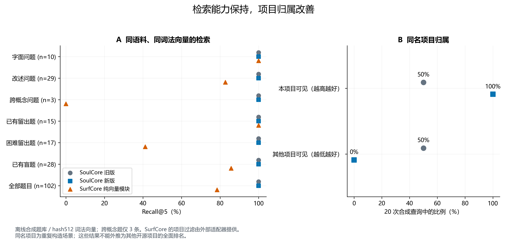
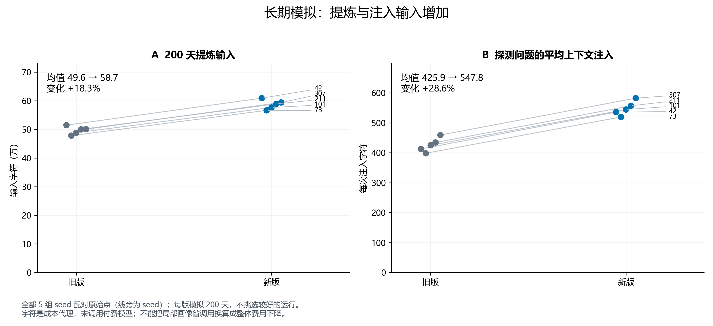
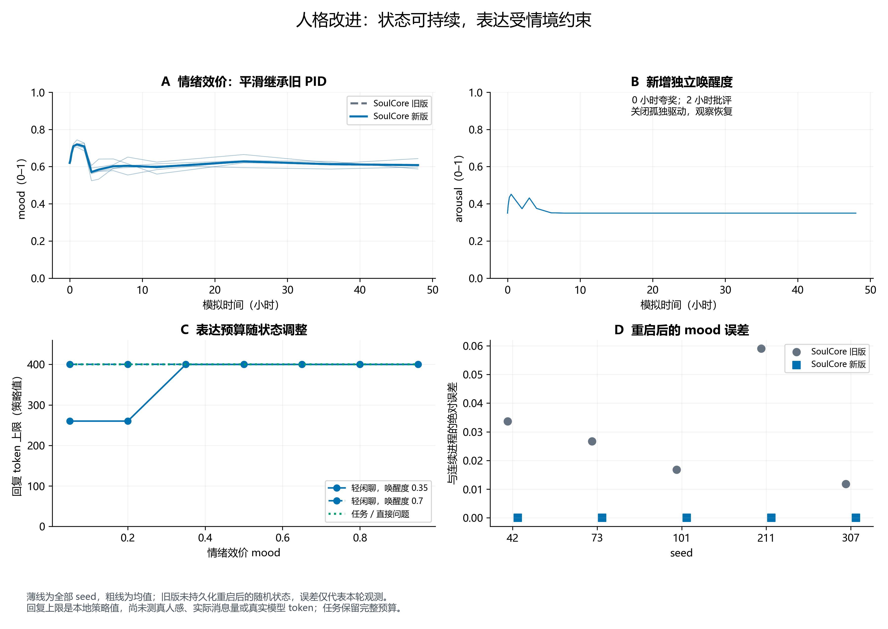
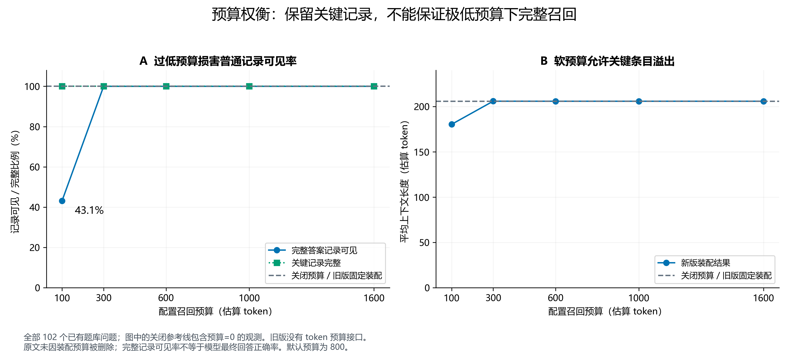

# SoulCore 人格与记忆实测报告

日期：2026-11-15。比较基线是 Git `d9e5da7` 的 SoulCore，改进版是本次冻结的源码；外部实测对象为本机 SurfCore 的实际向量模块。**当前优势主要是原文、归属、情绪连续性与局部省调用；还没有证明整体成本下降。**

## 已确认的提升

| 指标与测试范围 | 旧版 | 新版 |
|---|---:|---:|
| 同名项目：本项目记录可见（20次合成查询） | 10/20 | 20/20 |
| 同名项目：其他项目记录可见，越低越好 | 10/20 | 0/20 |
| 画像不变，连续20次反思的模型调用 | 20次 | 1次 |
| 上述画像场景的输入字符 | 4300 | 215 |
| 压缩抢救路径新增原文持久保存 | 0/6 | 6/6 |
| 长文本摘录保留中段约束/理由 | 1/6 | 6/6 |
| 4条定向任务批评：正确区分人格归因 | 2/4 | 4/4 |
| 五组重启回放：最大 mood 误差 | 0.059045 | 0.000000 |

画像场景少调用95%，不代表全部会话或总账单少95%。旧版普通对话本来就会存原文，表中0/6专指 `pre_compact` 抢救路径：旧实现临时构建条目并提炼，没有额外保存该批完整原文。新版六个用户/助手样本（962、4636、11060字符）均逐字保存。重复投递同一真实消息ID五次，新版此路径只保存一条原始turn；不能把旧版此路径不落盘描述为“存了五条重复记录”。

任务批评例包括“你这个方法错了”“你把配置改坏了”：应处理任务反馈，不误当作角色人格受辱；明确辱骂与道歉仍保留对应反应。已有128条分类题均100%，50条已有留出题均96%，本轮没有证明一般情绪分类准确率提高。

## 与 SurfCore 的实测比较

| 实际运行组件 | Recall@5（102题） | MRR | 本机组件延迟中位数 |
|---|---:|---:|---:|
| SoulCore 旧版检索 | 100.00% | 0.959 | 14.39ms |
| SoulCore 新版检索 | 100.00% | 0.959 | 14.53ms |
| SurfCore RAM 排序 | 78.43% | 0.635 | 0.20ms |
| SurfCore 读索引+排序 | 同上 | 同上 | 2.27ms |

同一份449条材料、102个问题、同一组512维确定性词法向量，直接调用 SurfCore 的 `rankVectorMemories`、索引读取和渲染API。SoulCore还使用自己的FTS、概念扩展和重排。**这证明这组题上的组件差别；旧版已100%，不能把此差距全部归功于新改动。** 数据集来自SoulCore仓库，存在偏向其中文领域/概念词表的可能，跨概念小类仅3题；没有独立真实用户盲测。摘要记录被测SurfCore模块的SHA256和SoulCore各模块hash。

SurfCore RAM排序更快，读盘后也更轻；SoulCore测的是SQLite检索完整路径。两者处理范围不同，不能作为整个插件速度排名。SurfCore的项目过滤由外部适配器提供，不是其原生项目UUID能力。它的向量入口会裁切/脱敏素材，不是完整会话档案；不能将此不同职责直接评为“丢原始对话”。本轮没有运行 Mem0、Letta等服务，也没有借用论文成绩冒充实测。



## 全部五组200天模拟

每个seed用相同填充剧本配对新旧版，约1600轮/版，顺序运行。以下为上下文关键词可见和旧值标记检查，**不是让真实模型回答后的人类评分**；另保存22个记忆探测问题的完整上下文和有效事实状态。

| 探测 | 旧版通过 | 新版通过 |
|---|---:|---:|
| 知识更新 | 40/40 | 40/40 |
| 时间回忆 | 19/20 | 19/20 |
| 长间隔回忆 | 30/30 | 30/30 |
| 普通召回 | 20/20 | 20/20 |
| 隐私探测通过 | 15/15 | 15/15 |

seed211中，新旧版都漏掉“昨天我们决定了什么”对应的“巡航速度0.3米每秒”；完整注入中没有该值。这个共同失败样本保留，时间回忆尚未全部通过，不能据此宣称长期记忆已无缺陷。

新旧版“更新后的有效fact/decision仍在库中”检查均为 100.00% / 100.00%。这个检查补充关键词可见率，防止旧摘要注释中的新关键词造成假阳性。

| seed | 每版模拟轮数 | 知识更新%：旧/新 | 提炼输入字符：旧→新 | 每次注入字符：旧→新 |
|---|---:|---:|---:|---:|
| 42 | 1667 | 100.0/100.0 | 514,858 → 609,262 | 412.7 → 535.9 |
| 73 | 1611 | 100.0/100.0 | 478,273 → 566,621 | 398.3 → 519.6 |
| 101 | 1654 | 100.0/100.0 | 488,244 → 576,547 | 425.0 → 544.4 |
| 211 | 1674 | 100.0/100.0 | 500,236 → 589,284 | 434.3 → 556.8 |
| 307 | 1626 | 100.0/100.0 | 500,651 → 594,137 | 459.2 → 582.4 |

五组平均提炼输入 `496,452 → 587,170` 字符（+18.3%）；每次注入 `425.9 → 547.8` 字符（+28.6%）；提炼调用 `223.2 → 224.0` 次。

长期库探测的平均上下文准备耗时 `97.3 → 112.0ms`（+15.1%），也增加了；这与449条小语料上的组件延迟是不同场景，不将两组时间混为一谈。

**成本目标仍未完成。** 更多来源编号、证据/状态说明和表达提示增加输入。实际账本已实现，但本轮使用MockLLM，没有供应商计费usage、缓存命中实价或真人对话，因此不能声称人民币、真实token或思考链长度下降。下一步宜做提炼提示/来源表示的独立消融，并以此套可靠性检查为回归门槛；不靠把默认召回预算压到100来省钱。



## 情绪与预算曲线

保留旧PID的平滑轨迹；新增独立唤醒度、随机状态持久化和本地表达策略。五组重启恢复与连续进程的mood完全一致。旧版序列化未保存随机状态，重启误差是本轮观察，不能将其小数当作可重复的固定效果量。模拟关闭孤独驱动，以查看事件后的自然恢复；产品默认孤独驱动没有改为关闭。

本地表达策略：低mood且低唤醒时，明确轻闲聊预算从400降到260；高mood且高唤醒时，允许最多3条消息；任务/直接问题保持完整预算。曲线展示配置上限，没有测真人感、真实生成消息数或实际token。概率安静仍默认关闭。



预算100时完整答案记录可见率43.14%，关键decision/todo/固定记录保持100%；均值仍约180.27估算token，因为软预算允许关键条目溢出。相对关闭预算，仅降低约12.4%估算注入token，却损失56.9个百分点的完整答案记录可见率。已测300/600/1000/1600及关闭预算时，完整答案记录均100%，约205.8估算token。**默认仍800**；长期模拟也使用此默认值。装配减少不删原始数据，但极低预算仍影响本轮可见信息。



## 修复、回归与复现

初轮seed42曾漏掉Cartographer；seed73虽关键词检查通过，当前事实实际上被误标过时。来源前缀混入启发式事实内容和冲突比较的污染已确定性复现。现仅剥离行首规范来源标记，再解析说话人和语义核心；结构化source_ids与完整原文保留，不自动重写用户历史库。新增6项回归，包含真实更新链路与X3→X5更新。初轮不完整数据保留于 `benchmark-diagnostics/pre-fix`，未混进最终五组结果。

完整Python回归381项通过；常规JavaScript回归最终39项（包含设置页用量/QQ作用域渲染回归）。Python首轮有3项WinError10013端口绑定失败；单独6项复测通过，再顺序完整复跑381项通过。已有资源未关闭警告仍出现在测试日志中，不将“无失败”说成“无任何警告”。本次保留实际目录里已有的HTTP/1.1连接设置；设置页已有的用量变量作用域修复纳入验证。

环境：Windows 11、Python3.13.5 / SQLite3.45.3、Node24.14.0。全程隔离临时数据库、MockLLM和合成素材，无付费调用。种子固定填充剧本；不同环境/旧版未持久化的随机源与本机负载仍可能使个别成本或时间数字变化。没有做延迟显著性检验。

复现脚本在 `core/bench/run_improvements.py`：传入旧版和新版core目录、输出目录、可选SurfCore目录。接着用 `report_improvements.py` 导出CSV/摘要，`plot_improvements.py`生成图。五seed均保留，清单记录退出码与源码hash，最后检查源码未变化。

完整运行时原始JSON由复现脚本输出；本目录保留可审阅摘要与CSV；配对数据见 [longmem.csv](tables/longmem.csv)，分类检索见 [retrieval.csv](tables/retrieval.csv)，预算见 [budgets.csv](tables/budgets.csv)，记忆探测完整上下文见 [probe-contexts.csv](tables/probe-contexts.csv)。数据审计与图表契约一并保留。原建议第三项接续卡/按需展开工具继续暂缓。


## 复现命令

在仓库目录运行，先导出两个固定提交，避免未提交的本地改动影响比较。下面相邻的输出目录应使用新的空目录；不要覆盖已有数据。

```powershell
git archive --format=zip --output ../soulcore-bench-before.zip d9e5da7
git archive --format=zip --output ../soulcore-bench-after.zip c40cbd0
Expand-Archive -LiteralPath ../soulcore-bench-before.zip -DestinationPath ../soulcore-bench-before
Expand-Archive -LiteralPath ../soulcore-bench-after.zip -DestinationPath ../soulcore-bench-after
python -X utf8 -B core/bench/run_improvements.py --before ../soulcore-bench-before/core --after ../soulcore-bench-after/core --out ../soulcore-bench-results --seeds 42 73 101 211 307
python -X utf8 -B core/bench/report_improvements.py ../soulcore-bench-results ../soulcore-bench-tables
python -X utf8 -B core/bench/plot_improvements.py ../soulcore-bench-tables ../soulcore-bench-figures
```

如需SurfCore组件比较，在run_improvements命令追加 `--surf-source C:/Projects/surfcore-main`，替换为包含实际被测模块的仓库路径；没有源码时该外部比较不会运行。运行比较和表格汇总使用标准库；绘图额外需要matplotlib、pandas、numpy，以及Microsoft YaHei/Noto Sans CJK SC/SimHei之一。

复现会保留所有seed、原始JSON、子进程输出、run-manifest.json和源码hash。数据审计、表格和四张PNG/SVG由后续脚本生成。执行耗时和旧版未持久的随机源受环境影响，不保证每个小数完全一样。

[项目入口](../../../README.md) · [使用指南](../../quickstart.md) · [配置](../../config.md) · [开发过程](../../development-notes.md)
