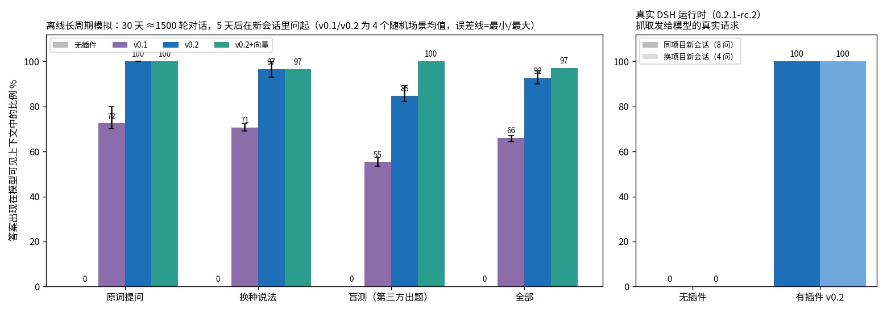
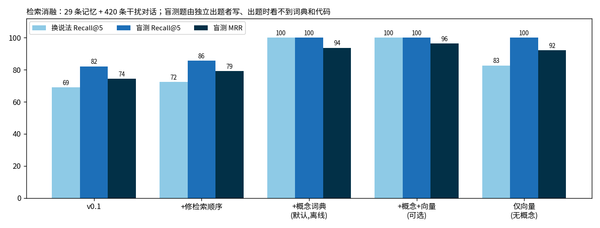
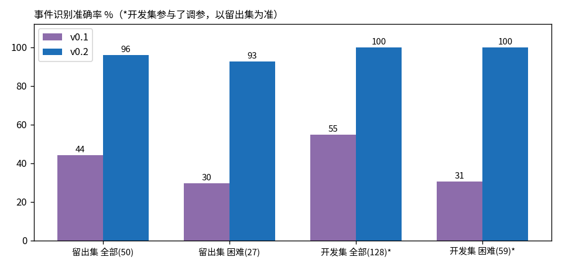
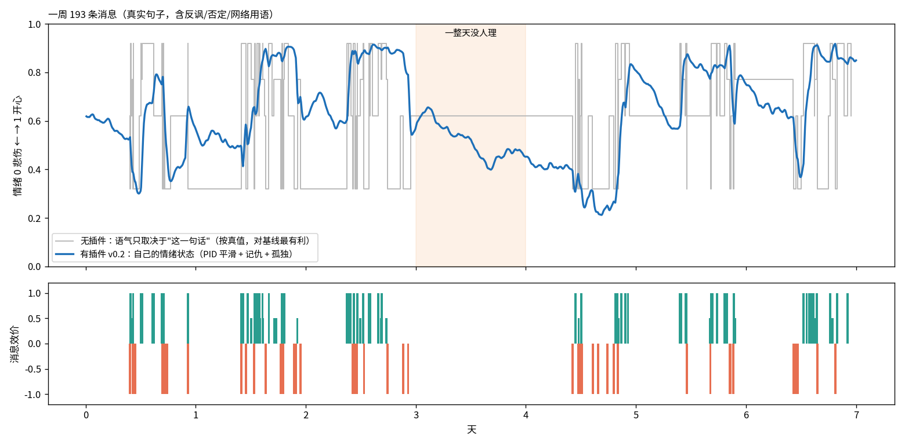

# dsh-soulcore v0.2 实验报告：有插件 vs 没插件

日期：2026-11-10。所有数字都能用 `core/bench/` 下的脚本复现，原始结果在 [`results.json`](results.json)。

## 结论

1. **跨会话记忆。** DSH 的新会话从空历史开始。
   - 没装插件时，上一个会话里说过的事，模型在新会话中**一件都看不到（0%）**。
   - 装了插件后，在**真实 DSH 运行时**里抓取发给模型的请求，**12/12** 道题的答案都在里面。
   - 在 30 天、约 1500 轮的长周期模拟里，**92%** 的问题能看到答案；配置语义向量后是 **97%**。
2. **比 v0.1 更强。** 换种说法问，以及由第三方出的盲测题，召回率提高最多：
   - 端到端盲测：55% → 85%，加语义向量后 100%。
   - 事件识别（留出集）：44% → 96%。
3. **情绪。** 没装插件时，模型的语气完全跟着"这一句话"走，镜像相关系数 1.00，相邻两条消息之间情绪平均跳 0.24。装了插件后，她有自己的状态：平均跳变降到 0.03（约 1/7），被凶后会记一段时间，被冷落一天情绪会往下走。
4. **代价。** 每轮多注入约 **410 字**，后端检索耗时约 **21 ms**；记忆库涨到 5 万条时检索约 42 ms。
5. **隐私。** 所有实验中，跨人、跨群泄露私人信息 **0 次**。



## 1. 实验方法：怎么判断"模型能不能知道"

在离线环境里调不了真模型，所以我们测的是**答案有没有出现在这一轮模型能看到的全部输入里**（system prompt 加所有消息）。这是模型答对的**必要条件**：输入里没有答案，再强的模型也只能瞎猜。

用自己的 DeepSeek Key 测"最终回答对不对"，见第 7 节。

## 2. 真实 DSH 运行时 A/B（最直接的证据）

`bench/ab_dsh.py` 的做法：

- 启动 DSH 0.2.1-rc.2 安装包里的真实运行时，以 `dsh headless` 模式运行。
- 把模型接口换成一个假 DeepSeek，它把 DSH 发出的每个请求原样记下来。
- 两组条件完全相同，唯一区别是加不加插件。

| | 无插件 | 有插件 v0.2 |
|---|---|---|
| 同项目、新会话，问 8 件之前说过的事 | 0 / 8 | **8 / 8** |
| 换一个项目目录、新会话，问 4 件个人信息 | 0 / 4 | **4 / 4** |
| system prompt 里有人设 | 否 | 是 |
| 模型可用的工具 | — | memory_search、remember、mood_status |
| 每轮注入的文字 | 0 | 168–301 字（均值约 220） |

同样在真实运行时里，我们把压缩阈值调小，强行触发了一次自动上下文压缩：插件在压缩前截获了原文，提炼出 2 条记忆存盘。

**真实运行时还测出了 3 个只在真环境里才会出现的 bug，已在 v0.2 修复：**

1. 在没有 Web 服务的 profile（headless、SDK）里，插件因为依赖 `webServer` 而**根本不会激活**。现在设置页改为按需挂载。
2. 插件日志写到了 stdout，污染了 `--json` 事件流。现在一律写到 stderr。
3. 自动压缩发生在插件拿到会话信息之前，导致抢救下来的记忆被存进错误的分支。

## 3. 长周期模拟：30 天以后还记得吗

`bench/ab_offline.py` 的设置：

- **对话量：** 3 个项目加 1 个 QQ 群，共 30 天、约 1500 轮。29 条关键信息以口语的方式混在某一天的对话里。
- **最保守的配置：** 不配 API Key，插件只能用规则从对话里自己提炼。
- **提问：** 最后一次对话 5 天后，在新会话里问 70 个问题。
- **重复：** v0.1 和 v0.2 各跑 4 个随机场景。

| 新会话里答案可见 | 无插件 | v0.1 | **v0.2** | v0.2 + 向量 |
|---|---|---|---|---|
| 原词提问 | 0% | 72% | **100%** | 100% |
| 换种说法 | 0% | 71% | **97%** | 97% |
| 盲测（第三方出题） | 0% | 55% | **85%** | **100%** |
| 全部 70 问 | 0% | 66% | **92%** | 97% |
| 每轮注入字数 | 0 | 472 | 411 | 409 |
| 每轮后端耗时 | 0 | 12 ms | 21 ms | 37 ms |
| 隐私泄露（群友打听主人私事） | — | 0 | 0 | 0 |

v0.2 的四个场景分别为 95.7%、94.3%、90.0%、90.0%；"v0.2 + 向量"只跑了 1 个场景，使用本地 bge-small-zh 模型。

**"不装插件但把历史全塞进去"可以吗？** 这 30 天里，光用户说的话就有约 9,500 字。再加上模型的回复（真实使用中每条几十到几百字），总量通常在几万到几十万字。每轮都带上的话，是插件注入量（约 410 字）的几十到几百倍。而且跨会话时，DSH 本来就不会带上旧历史。

## 4. 检索改进：消融实验



`bench/eval_retrieval.py` 的数据：29 条记忆加 420 条故意共享字词的干扰对话。题目分三组：

- **换说法**（29 题）
- **盲测**（28 题）：由一个独立的出题方写，出题时看不到词典和代码。
- **困难留出**（17 题）：我写的，但词典有部分是在看过这些题之后才补的，**这组已被污染，只作参考**。

| 版本 | 换说法 R@5 | 盲测 R@5 | 盲测 MRR | 隐私泄露 |
|---|---|---|---|---|
| A. v0.1 | 69% | 82% | 0.74 | 0 |
| B. + 修检索顺序 | 72% | 86% | 0.79 | 0 |
| **C. + 概念词典（v0.2 默认，离线）** | **100%** | **100%** | 0.94 | 0 |
| D. + 概念词典 + 语义向量（可选） | 100% | 100% | **0.96** | 0 |
| E. 只用语义向量（无词典） | 83% | 100% | 0.92 | 0 |

v0.2 检索改了什么：

- **概念词典：** 约 90 组近义词，覆盖中英文和口语说法（例如"陀螺仪 / IMU / 惯性测量单元"），文档和查询两边都加上概念标记。完全离线，不需要任何依赖。
- **修检索顺序（v0.1 的真 bug）：** 对方档案分支先被搜，可能占满全部名额，把当前项目的记忆挤掉。
- **问句降权：** 以前问过的问题本身不是答案。v0.1 会把"上次问的那句话"当成记忆召回。
- **原话和提炼条目去重。**
- **只把半小时内的上文拼进查询：** 几天前的旧话混进来只会带偏检索。
- **可选语义向量：** 支持 OpenAI 兼容的 `/embeddings` 接口，例如硅基流动的 bge-m3、本地 Ollama，或本地的 fastembed，与字词检索混合打分。没配置时完全离线运行。
- **LLM 提炼时生成别名关键词：** 例如为"深色主题"生成 dark mode、夜间模式，一起写进索引。

**规模：**

| 记忆条数 | 平均耗时 | P95 耗时 | 数据库大小 |
|---|---|---|---|
| 2,000 | 10 ms | 14 ms | 1.1 MB |
| 20,000 | 16 ms | 18 ms | 10 MB |
| 50,000 | 42 ms | 71 ms | 27 MB |

## 5. 事件识别



| | v0.1（关键词） | v0.2（打分 + 否定 + 对象 + 反讽） |
|---|---|---|
| **留出集 全部（50）** | 44% | **96%** |
| 留出集 困难样本（27） | 30% | **93%** |
| 开发集（128，参与了调参） | 55% | 100% |

v0.1 典型的错法：

| 原句 | 正确理解 | v0.1 的判断 | 问题类型 |
|---|---|---|---|
| "你一点也不笨" | 夸 | 没识别出来 | 否定 |
| "你不傻啊，挺聪明的" | 夸 | 骂 | 否定 |
| "老王真笨" | 闲聊（不是在说她） | 骂 | 对象 |
| "滚动条怎么隐藏" | 闲聊 | 骂 | 误伤 |
| "垃圾回收机制" | 闲聊 | 骂 | 误伤 |
| "你可真厉害呢🙄" | 骂 | 夸 | 反讽 |
| yyds、无语、👍 | 夸 / 骂 / 夸 | 都没识别出来 | 网络用语、表情 |

v0.2 还会输出**强度**：太、超、真会放大，有点、稍微会减弱，否定翻转时减半。这个强度会乘到情绪冲击上。

开发集是调参时用过的，以留出集为准。留出集一共 50 条，规模不大。

## 6. 情绪：有插件 vs 没插件



`bench/ab_emotion.py` 的设置：一周 193 条真实句子，其中第 4 天整天没人理。

基线"无插件"假设模型每句话都理解得**完全正确**，语气等于 0.62 + 0.3 × 这句话的效价。这对基线是最有利的假设。

| | 无插件 | 有插件 v0.1 | **有插件 v0.2** |
|---|---|---|---|
| 相邻消息间情绪平均跳变 | 0.244 | 0.037 | **0.034** |
| 相邻消息间最大跳变 | 0.60 | 0.53 | **0.24** |
| 镜像度（与"这一句"的相关系数） | **1.00**（完全跟着用户走） | 0.27 | 0.35 |
| 被凶后多久回到之前的心情 | 0 分钟（下一句就忘） | 170 分钟 | 332 分钟 |
| 一整天没人理后的情绪下降 | 0 | 0.38 | 0.13 |
| 情绪变化方向反了（事件识别错） | — | 31% | **16%** |
| 消息流中事件识别准确率 | — | 59% | 99%* |

\* 消息流取自开发集加留出集，开发集参与了调参。

怎么理解这张表：

- **镜像度：** 无插件的 1.00 说明它没有自己的状态。插件的 0.3 左右说明她会受用户影响，但主要由自己的状态和经历决定。这就是"独立人格"在数据上的体现。
- **平滑度：** 每 10 分钟情绪最多变化 0.08，由限速保证，从不跳变。
- **"记仇"时长偏长：** v0.2 的 332 分钟偏长。原因是这条测试消息流里约 25% 是骂人的话，比真实聊天密集得多。想调短可以改 `tau_slow` 或 `sensitivity`。

## 7. 用真模型复测（需要你自己的 Key）

```powershell
cd C:\Users\LENOVO\.dsh\plugins\dsh-soulcore\core
$env:DEEPSEEK_API_KEY="sk-..."
python bench/ab_dsh.py --cli "<DSH 安装目录>\resources\runtime\cli\bin\dsh.cmd" --plugin-patch ..\cordis.patch.yml --out real.json --real
```

`--real` 模式不再检查"答案可不可见"，而是检查**模型最终回答里有没有说出答案**。

## 8. 局限

- **离线评测只测可见性：** 测的是答案在不在模型能看到的输入里，不是模型最终答得对不对；后者需要真 Key，见第 7 节。
- **规则提炼的天花板：** 无 Key 时，用规则提炼会漏掉没有明显关键词的事实。这也是 v0.2 盲测停在 85%、而加了向量能到 100% 的主要原因。
- **数据集规模：** 都是几十到一百多条，适合比较版本之间的差异，不代表大规模线上表现。
- **困难留出集已被污染：** 它在写概念词典前已经被看过。所以检索结论以第三方盲测为准，事件识别以留出集为准。
